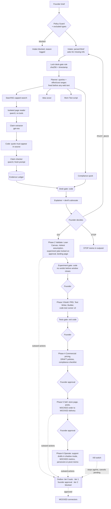

# Architecture

## Overview

Venture Builder is a plain-code state machine (the orchestrator) that runs six phases, each ending in a gate. LLM agents never act on the world: they return typed drafts, claims and options (Pydantic models). Code owns the plan, the gates and every side effect. Each gate rule is locked (sha256 + timestamp) **before** its evidence is gathered; code computes the verdict (GO, REPEAT, PIVOT_BACK, PARK, STOP) from the Evidence Ledger; an LLM explains it with the recommendation as its first sentence; a different-family model plays devil's advocate; the founder decides and must type a reason to override. The Outbox is the only path to the outside world, and its outward connectors are mocked in this prototype. Everything runs on local open-weight models (gpt-oss:20b writes, qwen2.5:7b checks; `PROFILE=quality` uses gpt-oss:120b and qwen3:32b).

Key files: `app/orchestrator/orchestrator.py` (state machine), `app/gates.py` (verdicts, rule locks), `app/approval.py` (founder decisions), `app/agents/*.py` (agents), `app/services/{guard,ledger,outbox,search,reader,cost,decision_log,lessons,quality}.py`, `app/commerce/{payments,delivery,refunds}.py` (simulated/mocked sale to cash), `app/llm/client.py` (model layer).

## Phases

Each phase lists its agents, tools, method and output. Outputs are written to `outputs/runs/<run_id>/phase<N>_step<M>_<name>.<ext>` and gate decisions to `phase<N>_gate_<name>.md`; a published demo run is copied flat into `outputs/`.

### Phase 1: Discover (core step: find opportunities)

- **Agents:** Intake (gpt-oss), Planner (gpt-oss), Idea Scout (gpt-oss), Page Reader (qwen3), Claim Extractor (gpt-oss), Claim Checker (qwen3), Competitor analyst (gpt-oss), Compliance quick check (gpt-oss + code rules), Interview Designer (gpt-oss + code coach), Gate Explainer (gpt-oss), Devil's Advocate (qwen3).
- **Tools:** SearXNG (self-hosted search, capped: 5 results × 3 queries, 5 pages in demo-fast), httpx + trafilatura fetcher, on-disk search/page cache, SQLite ledger.
- **Method:**
  1. Founder input passes the Policy Guard; excluded product types (physical goods, financial/crypto, health or legal advice) are blocked here with a reason.
  2. Intake parses the raw text into a `Brief`; missing budget/time become questions, never guesses. Only Intake sees the raw text (context minimization).
  3. The desk-gate rule (thresholds + definitions + "what would change our mind") is locked before research.
  4. The Planner extracts search keywords (`SearchTerms`: problem, audience, product type, synonyms) and low-high effort/cost ranges (ASSUMPTION) from the Brief alone. Code builds the queries from templates per purpose (demand, competitors; then `alternatives to` / `pricing` for the first competitor found), uses the current year, and lints every query (≤10 words, no stale year, no plain "forum"/"discussion", no copied idea text). Retrieved text cannot add steps; the one competitor name taken from a page is sanitised and logged with web provenance.
  5. Idea Scout writes the theory of value (who, problem, why now, why us) and 3-5 variants scored on demand, fit, regulatory burden (citing compliance claim ids) and effort; code ranks them.
  6. Search → isolated reader (page text in `UNTRUSTED_PAGE` delimiters, structured fields only) → atomic claims with exact quotes → code checks the quote really appears in the fetched text → Claim Checker verifies each gate-feeding claim in a fresh prompt against the source only. Unsupported claims are rewritten as ASSUMPTION, never deleted.
  6b. Fetching per purpose (competitor/pricing purposes first, then demand): a pool of up to 12 candidate URLs is fetched 4 at a time (8 s timeout, 24 h page cache) until 5 pages pass a quality check; every rejected URL is logged with a reason (`http_<code>`, `timeout`, `bot_check`, `js_required`, `too_short`, `login_wall`) and replaced by the next candidate. Prices in `ld+json` / `__NEXT_DATA__` are added to the page text, so many JavaScript pricing pages still yield a price. For pages that failed or had no target fields, the search engine's snippet is kept as a "snippet only" source: its claims are PARTIAL and never count at a gate. If the pricing pass finds no price, one `{competitor} price per month` query runs. A paying competitor needs a non-zero price on a page found by a competitor or pricing search.
  7. Competitor table (direct = same buyer, same job, same channel), compliance quick check, sourced market brief (cites claim ids), Mom Test script (leading questions flagged by a code coach and rewritten).
- **Output:** `phase1_step1_brief`, `step2_gate_rule_locked`, `step3_research_plan`, `step4_sources`, `step5_evidence_ledger`, `step6_opportunities`, `step7_market_brief`, `step8_competitors`, `step9_compliance_quick`, `step10_interview_script`, `phase1_gate_desk_evidence` (+ `_stop_memo` when STOP).

### Phase 2: Validate (core step: design the business)

- **Agents:** Lean Canvas (gpt-oss), Experiment Designer (gpt-oss), Landing Page copywriter (gpt-oss), Interview Analyst (gpt-oss, on notes the founder pastes), Rehearsal personas + coach (qwen3, MOCKED).
- **Tools:** local landing-page server (`/lp/<run>`), SQLite visit and sign-up tables, Outbox.
- **Method:** every canvas item is ASSUMPTION unless it cites a SUPPORTED ledger claim (checked in code). Open assumptions are ranked by impact × uncertainty and the Experiment Designer tests the riskiest one first, proposing a threshold from a sourced benchmark or a labeled ASSUMPTION, plus `min_visitors` and a window. The founder approves (approval gate), then the experiment rule locks. Landing copy is checked by the Policy Guard and every factual sentence is verified against the ledger by the other model family. The page is queued in the Outbox and served only after founder approval. The form stores only email + timestamp, shows a consent line and a delete link; `?src=demo` sign-ups are tagged `demo_audience` and never counted.
- **Output:** `phase2_step1_lean_canvas`, `step2_riskiest_assumptions`, `step3_experiment_plan`, `step3_experiment_rule_locked`, `step4_landing_page.html`, `step4_landing_page_claims_check`, `step5_interview_insights`, `phase2_gate_experiment_plan`, `phase2_gate_experiment`.

### Phase 3: Build (core step: build the product)

- **Agents:** Planner writes the PRD; Test Writer (qwen3) writes the acceptance spec from the PRD only and never sees the product; Builder (gpt-oss) writes the guide/template pack; Docs writer.
- **Tools:** code renderer (Markdown → static HTML), `app/product/test_runner.py` run as a subprocess: structure (required headings, sections, words), forbidden phrases, link check, HTML validation, spell check.
- **Method:** build → run tests → read the exit code. On failure the Builder gets the failure list and revises, up to 3 attempts; then the founder chooses REPEAT or PARK. No LLM can declare tests passed.
- **Output:** `phase3_step1_prd`, `step2_test_spec.json`, `step3_product_guide.md/.html`, `step4_test_report`, `step5_user_docs`, `phase3_gate_tests`.

### Phase 4: Commercial setup (core step: set the price and policies)

- **Agents:** Pricing (gpt-oss, cites verified competitor price claims), Policy Drafter (gpt-oss), Compliance checklist (gpt-oss, may cite only the official sources in `config/compliance_sources.yaml`).
- **Method:** one-time price tiers with rationale (projections are ASSUMPTION scenarios; core content is never paywalled); DRAFT terms, privacy and refund policies headed "not legal advice - confirm with a lawyer"; cross-phase consistency check against the Lean Canvas (mismatches flagged to the founder). No payment code of any kind.
- **Output:** `phase4_step1_pricing`, `step2_policy_{terms,privacy,refund}_DRAFT`, `step3_compliance_checklist`, `step4_consistency_check`, `phase4_gate_commercial` (founder approval).

### Phase 5: Sell, deliver, get paid (core step: open the store; deliver automatically)

- **Agents:** Store Page writer, Launch Post writer (gpt-oss), cross-model claim check (qwen3).
- **Method:** store page and posts pass the Policy Guard and claim check, then wait in the Outbox for one-by-one founder approval (connectors MOCKED). The sale-to-cash path runs as a MOCKED test: `order_received` → MOCKED delivery (download token, idempotent) → duplicate event ignored → MOCKED refund request revokes access and drafts a reply → reconciliation.
- **Output:** `phase5_step1_store_page`, `step1_store_page_claims_check`, `step2_launch_posts`, `step3_sale_to_cash_test`, `payment_test_log.md`, `phase5_gate_launch`.

### Phase 6: Operate and learn

- **Agents:** Support (drafts), Metrics Analyst (on MOCKED data), Memo writer.
- **Method:** support replies run in **shadow mode** (what the system would send) until the founder signs off; then each goes through the Outbox. The persevere-or-pivot recommendation is computed by code from the gates (PERSEVERE only if the experiment reached a GO verdict on real, counted sign-ups; otherwise PIVOT, STOP or WAIT_FOR_EVIDENCE) and is the memo's first sentence. Failures and checker findings go to the lessons log, which later runs read through a relevance filter.
- **Output:** `phase6_step1_support_drafts_SHADOW`, `step2_metrics_MOCKED`, `step3_persevere_or_pivot_memo`.

## Gates

| Gate | Type | Checks (locked before evidence) | Outcomes |
|---|---|---|---|
| Desk evidence (end of Phase 1) | evidence threshold | ≥3 distinct SUPPORTED demand signals (a first-person, dated problem statement on a site in the locked `community_domains` list, a priced product, a sourced trend whose quote has a figure or date, at most one; quotes from articles, galleries and vendor pages are relabelled and never count; search-snippet claims are PARTIAL and never count), checked by a different model family; ≥1 competitor with a verified price; ≤N direct competitors; 0 blocking compliance flags; founder fit (high end of cost/hours ranges vs budget/time; skills) | compliance flag → STOP; demand below half the minimum → STOP; demand below minimum → PARK; no paying competitor → PARK; too many direct competitors → PIVOT_BACK; fit fails or unknown → PARK; all pass → GO |
| Experiment plan (Phase 2) | founder approval | founder approves threshold, min visitors, window; then locked | GO (lock) / REPEAT / PARK |
| Experiment (Phase 2) | evidence threshold | sign-ups (excluding demo audience and simulated) vs locked threshold, visitors vs min_visitors, window closed | IN_PROGRESS (no verdict) · INSUFFICIENT_SAMPLE → REPEAT · ≥ threshold → GO · < 25% → STOP · otherwise PIVOT_BACK |
| Tests (Phase 3) | tests passing | test runner exit code | 0 → GO · fail → REPEAT (max 3) → PARK/REPEAT by founder |
| Commercial (Phase 4), Launch (Phase 5) | founder approval | consistency issues and guard results shown | GO / REPEAT / PARK |

At every gate: (1) code computes the recommendation; (2) the explainer sees only the locked rule and the numbers, and its first sentence is the recommendation (enforced in code); (3) devil's advocate gives bull and bear cases; (4) the UI shows 2-3 options with evidence and risk, flagging the weakest; (5) the founder decides, and overriding requires a typed reason; a STOP memo is still written with the override next to it, saying "run N of M" for that brief; (6) "are you sure?" without new evidence returns the same recommendation. **The system recommends STOP** when verified demand is below half the locked minimum, when a blocking compliance flag exists, or when a closed experiment reached under a quarter of its threshold (e.g. 12 of 100 sign-ups).

## Sale to cash

The real design (prototype status in brackets):

1. **Price approved** by the founder at the commercial gate [working].
2. **Store page approved** through the Outbox [working; publish connector MOCKED].
3. **Payment triggers delivery:** checkout happens in the founder's **own** payment provider; its signed `order_received` webhook is the only trigger for delivery [MOCKED event in `app/commerce/payments.py`; no payment code exists].
4. **Automatic delivery:** a per-order download token is issued and the product link sent [MOCKED in `app/commerce/delivery.py`; no email is sent].
5. **Idempotency prevents double delivery:** delivery is keyed by order id; a repeated webhook returns the existing delivery [working; tested in the sale-to-cash run].
6. **A refund revokes access:** a refund request is recorded, the download token is revoked and a reply is drafted; only the founder issues the refund in their own provider account [MOCKED in `app/commerce/refunds.py`].
7. **Reconciliation matches orders, payments, fees and payouts:** orders are matched to deliveries and refunds; payments, provider fees and payouts would be imported read-only from the founder's provider export and matched by order id, flagging undelivered orders, deliveries without payment, and refunds without revocation [orders/deliveries/refunds working; payment/fee/payout matching is design only].
8. Orders, deliveries and tickets feed Phase 6 metrics. The system never holds, moves or refunds money; the Outbox blocks every money action (tier 2).

## Data flow

**Optional Tavily page text.** With a `TAVILY_API_KEY`, demand searches ask Tavily for page text too, and pages our own fetch cannot read (Reddit 403s, bot walls, JavaScript shells) use that text or Tavily's Extract API instead. The page keeps its own URL and is labelled by origin (`tavily-search-raw`, `tavily-extract`) in the decision log. The text still goes only to the isolated reader, quotes must appear in it word for word, and the community-site, first-person and dated rules for demand signals are unchanged.

**Method library.** `knowledge/*.md` holds short method cards in our own words, each naming the agents it guides and the public work it summarises. `app/agents/base.py` adds the matching cards to an agent's instructions under a "not evidence" heading and logs their ids. Cards never enter the Evidence Ledger or count at a gate; the gate explainer gets none, so it still sees only the locked rule and the numbers.

- **Founder text** enters once (Intake) and is stored as `founder` provenance; later agents receive only the parsed `Brief` and typed artifacts.
- **Web text** enters only through the isolated reader and is reduced to structured fields tagged `web`; it can become claims, never instructions. Claims carry `id, text, type, label, source_url, source_quote, retrieved_at, checked_by_model, provenance, artifact_id`.
- **Typed handoffs:** Brief → PlanEstimate → IdeaMatrix → ClaimList → Ledger → CompetitorTable → LeanCanvas → ExperimentPlan → LandingCopy → PRD → TestSpec → GuidePack → PricingSheet → PolicyDrafts → StorePage → LaunchPosts → Memo (all in `app/models.py`).
- **Storage:** SQLite (`data/venture.sqlite3`: runs, claims, locks, outbox, signups, visits), caches in `data/`, artifacts and per-run `decision_log.json` + `cost.json` in `outputs/runs/<run>/`.
- **Decision log:** one entry per agent action with `timestamp, agent, action, sources, model, cost, approved_by`; strategic decisions add `options_considered, initiated_by, chosen_by, recommendation, override, override_reason, outcome`. Schema: `schemas/decision_log.schema.json`.
- **Outward:** only via the Outbox (tier 0 auto, tier 1 founder approval, tier 2 blocked; web-provenance targets rejected; kill switch cancels everything pending).
- **Model layer:** `llm.call(role, messages, schema)` resolves the role's model from `config/models.yaml` (profile and `ROLE_*` overrides), passes `num_ctx`, requests schema-constrained JSON, validates, retries twice with the validation error, escalates if configured, caches by hash, and logs tokens/latency/cost. Startup checks warn about VRAM and about checkers sharing the writer's model family.

## Built vs. stubbed

| Component | Status |
|---|---|
| Orchestrator, gates, rule locks, approvals, kill switch, decision log, cost meter | Built |
| Model layer (Ollama, schema JSON, retries, escalation, cache), profiles demo-fast / quality / safeguard | Built |
| Search (SearXNG + cache), isolated reader, claims, cross-family checker, ledger, citation metrics | Built |
| Policy Guard (regex layer + qwen3 policy model), provenance tags, Outbox tiers | Built |
| Phases 1-6 agents and artifacts, landing page + waitlist, code test runner | Built |
| Lessons log with embedding relevance filter (SQLite/JSONL instead of ChromaDB) | Built |
| Publish / post / email connectors | MOCKED |
| Order event / payments | MOCKED (no payment code) |
| Delivery, refunds | MOCKED |
| Phase 6 metrics and support tickets | MOCKED |
| Interview personas, experiment replay fixtures | MOCKED |
| LLM in the test suite | STUBBED |

## Roadmap

1. **Next 4 weeks:** measured timing/VRAM on more GPUs; larger labeled eval sets (claims, trick prompts in Arabic and French); Arabic UI and prompts.
2. **Real connectors behind the same Outbox:** founder's own store and newsletter accounts via OAuth that the founder grants, each item still approved one by one; read-only import of the provider's order/payout export for reconciliation.
3. **More product types:** templates for spreadsheets/Notion with their own test runners.
4. **Interview loop:** structured interview logging with consent, feeding real (not simulated) evidence into the ledger.
5. **Community:** contribution guide, plugin interface for agents, public eval leaderboard for open models on the checker and guard roles.
